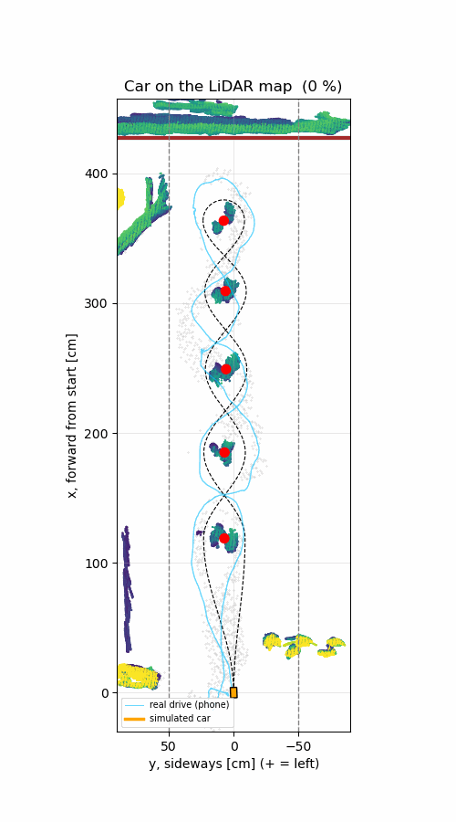
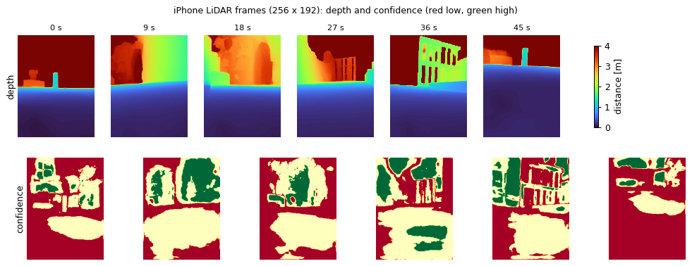
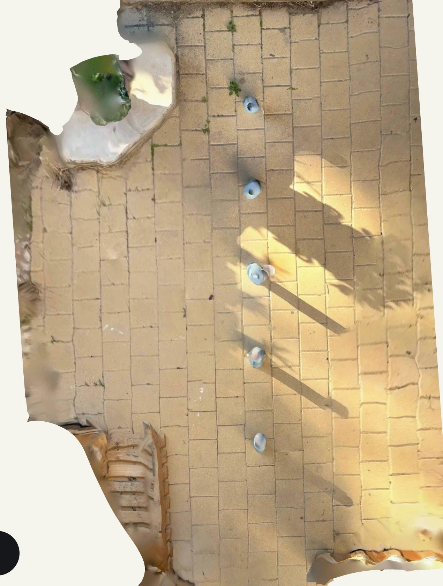
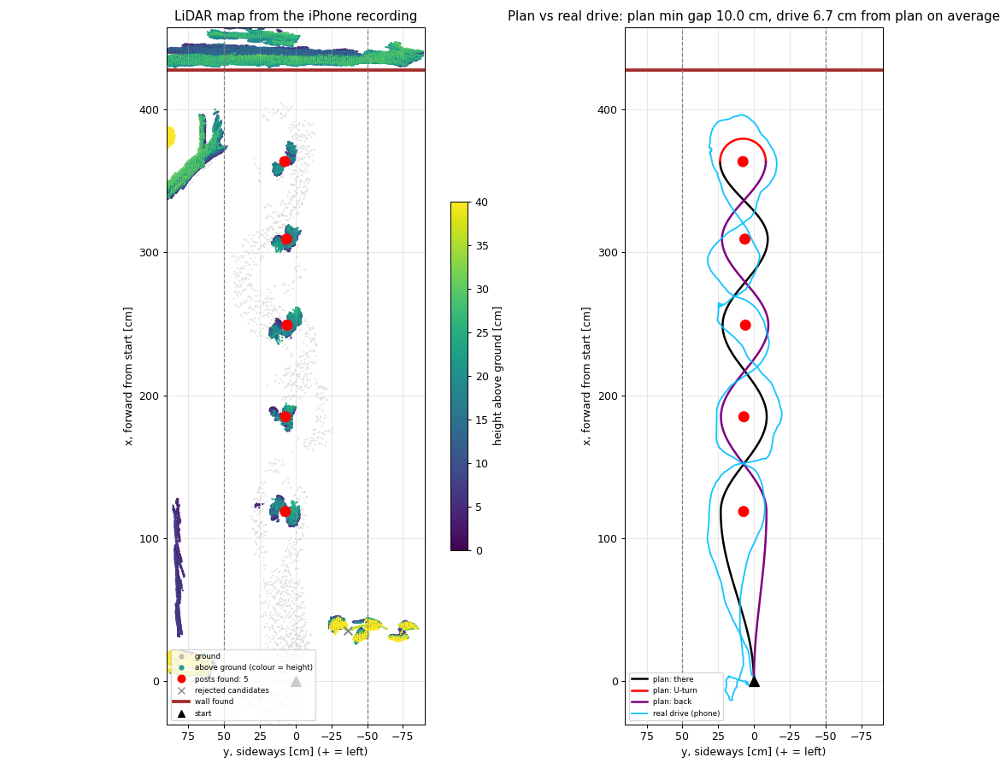
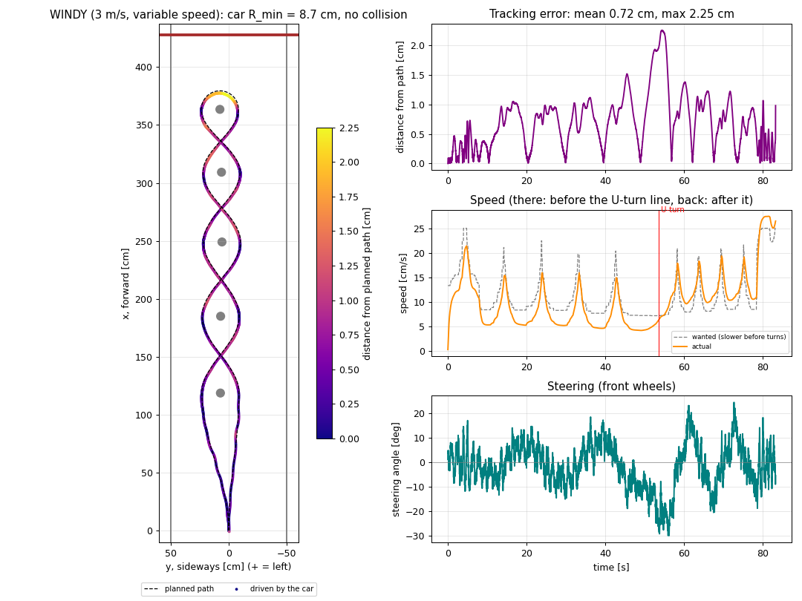
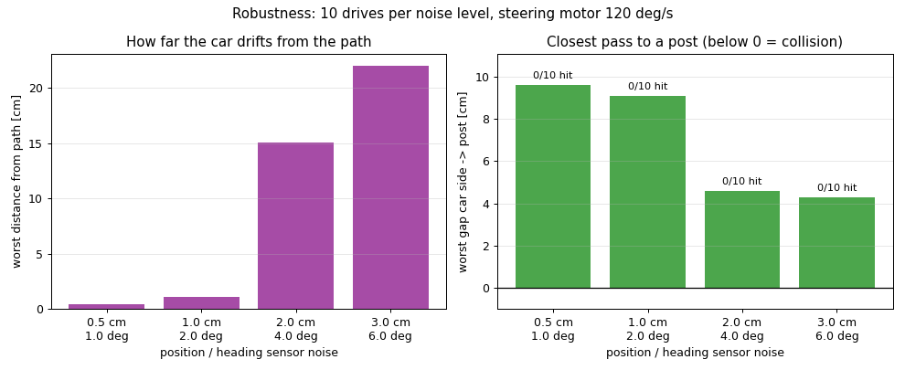

# Minicar Slalom — LiDAR version (ROS 2 Jazzy in Docker)

> **This is the LiDAR variant of the project.**
> The camera variant (top-view photo + drive video) is in branch
> [`main`](https://github.com/MilkaKaplan/minicar-slalom/tree/main).
> The camera code is still in this branch (to compare), but this README is about the LiDAR.

A small car has to drive a **slalom between posts, turn around at the end and slalom back**
to the start, inside a 1 m wide corridor, without touching the posts.

In the camera variant the track had to be **known in advance** (posts 50 cm apart) to turn
pixels into centimetres. On a real competition track nobody tells you that. Here an
**iPhone LiDAR** recording is used, and the system **measures the track itself**: it builds a
3D map of the yard, finds the posts and the wall, plans the slalom, compares it with the
real drive, and lets a simulated car drive it — with wind and variable speed.

Known in advance are only **our car** (5 cm wide, wanted gap 10 cm) and the **rules**
(corridor 1 m wide).



*The simulated car (orange) driving the planned slalom on the LiDAR map of the yard, with a
3 m/s wind and variable speed. Blue: the path the phone really took.*

---

## Contents
- [Quick start](#quick-start)
- [The task](#the-task)
- [Dataset](#dataset)
- [Pipeline](#pipeline)
- [How it works](#how-it-works)
- [Results](#results)
- [Camera vs LiDAR](#camera-vs-lidar)
- [Limitations](#limitations)
- [Repository layout](#repository-layout)

---

## Quick start

Requirements: **Docker** with **Compose v2** (Docker Desktop on Mac/Windows).

```bash
git clone -b lidar-v2 https://github.com/MilkaKaplan/minicar-slalom.git
cd minicar-slalom
docker compose --profile lidar up --build --exit-code-from lidar_processing lidar_replay lidar_processing
```

The first build downloads ROS 2 Jazzy (~1 GB). The run takes about 2 minutes (most of it is
drawing the animation). Both containers stop by themselves with exit code 0.
Results appear in `results/lidar/`:

| File | Content |
|---|---|
| `lidar_map.png` | the LiDAR map with the posts and wall found, the plan and the real drive |
| `lidar_drive.gif` | the simulated car driving on the LiDAR map |
| `lidar_result.json` | posts, distances, plan checks, real drive vs plan, LiDAR vs hand measurements |
| `path.csv` | the planned path as points `(part, x_cm, y_cm)` |
| `sim_ideal`, `sim_realistic`, `sim_windy` `.png/.gif` | simulated drives |
| `sim_robustness.png`, `sim_result.json` | 40 drives with more and more sensor noise |

Experiments without changing code:

```bash
# no wind / stronger wind (6 m/s: the car cannot drive against it)
docker compose run --rm lidar_processing ros2 launch /ros2_ws/lidar.launch.py wind_cm_s:=0.0
docker compose run --rm lidar_processing ros2 launch /ros2_ws/lidar.launch.py wind_cm_s:=600.0
# a car that cannot steer as much
docker compose run --rm lidar_processing ros2 launch /ros2_ws/lidar.launch.py max_steer_deg:=10.0

# stop and clean up everything
docker compose --profile lidar --profile video down --remove-orphans
```

If Docker says `network ... not found`, an old stopped container still points to a removed
network: run the clean-up command above and start again.

---

## The task

```
                 wall
  ───────────────────────────────
            ╭──●──╮                U-turn around the last post
            ╰╮   ╭╯
             ╳                     ● paper post
            ╭╯   ╰╮                ╳ the path crosses the post line between posts
            ╰──●──╯
              ...                  corridor 1 m wide
            ╭──●──╮                first post: passed on one side on the way there,
             ╲   ╱                             on the other side on the way back
              ▲  start
```

1. **There**: slalom — post 1 on one side, post 2 on the other, …
2. **U-turn** around the last post, without touching the wall behind it.
3. **Back**: slalom to the start, passing every post on the **other** side (a figure of eight).
4. Never touch the posts, the corridor edges or the wall.

---

## Dataset

A slalom in a paved yard: **5 paper posts** (Ø ≈ 7 cm), recorded with the iPhone LiDAR
using the [Stray Scanner](https://apps.apple.com/app/stray-scanner/id1557051662) app while
driving the phone ≈ 5–10 cm above the ground along the slalom: there, U-turn, back.
Folder `data/lidar_drive/`, statistics in [`docs/lidar_dataset_stats.json`](docs/lidar_dataset_stats.json).

| File | What it is |
|---|---|
| `depth/000000.png …` | **1661 depth frames**, 256 × 192 pixels, distance in mm (16-bit PNG) |
| `confidence/…` | for every depth pixel: 0 = low, 1 = medium, 2 = high confidence |
| `odometry.csv` | **phone pose** for every frame from ARKit: position (m) + orientation (quaternion) |
| `camera_matrix.csv` | camera focal length and centre (for the 1920 × 1440 video) |
| `imu.csv` | accelerometer + gyroscope, 100 Hz (recorded, not used) |
| `measurements.json` | hand measurements — used **only to check** the result |
| `polycam_top_view.webp` | the same track scanned with Polycam (illustration) |



| Property | Value |
|---|---|
| Duration / frames | 48.5 s, 1661 frames (34 per second) |
| Depth confidence | low 40 %, medium 43 %, **high 17 %** of the pixels |
| Distance of high-confidence points | median 1.9 m (the pipeline only uses points closer than 2 m) |
| Phone path | **10.6 m**; ends **9.7 cm** from where it started |
| Phone height above the ground | ≈ 5 cm, varied by 12 cm during the drive |
| Phone speed | 22 cm/s on average |

**Hand measurements** (tape measure, approximate): 5 posts, ≈ 53 cm apart, corridor 1 m,
start mark 93 cm before post 1, last post → wall 62 cm, post diameter ≈ 7 cm.



*The track scanned with Polycam (for illustration only, not used by the pipeline).*

---

## Pipeline

Two containers (Ubuntu 24.04, ROS 2 Jazzy, Python 3.12), three ROS 2 nodes:

```
 ┌── container 1 ───────────────────┐                     ┌── container 2 ──────────────────────────────┐
 │ lidar_replay                     │ /phone/depth        │ lidar_mapper                                │
 │  plays data/lidar_drive/ like    │ /phone/confidence ─►│  frames → 3D map → ground → posts → wall    │
 │  live sensors (every 2nd frame)  │ /phone/pose         │  → plan slalom → compare with real drive    │
 │                                  │ /phone/camera_info  │  ─► /slalom/path, /slalom/posts,            │
 └──────────────────────────────────┘                     │     /slalom/limits ──────────────┐          │
                                                          │                                  ▼          │
                                                          │ car_simulator                               │
                                                          │  ideal, realistic, windy drives, stress test│
                                                          │  ─► /sim/driven_path ──► lidar_mapper draws │
                                                          │                          the car on the map │
                                                          └─────────────────────────────────────────────┘
```

| Topic | Message | From → to |
|---|---|---|
| `/phone/depth` | `sensor_msgs/Image` 16UC1 (mm), 256 × 192 | replay → mapper |
| `/phone/confidence` | `sensor_msgs/Image` mono8 | replay → mapper |
| `/phone/pose` | `geometry_msgs/PoseStamped` (ARKit world) | replay → mapper |
| `/phone/camera_info` | `sensor_msgs/CameraInfo` (latched) | replay → mapper |
| `/slalom/path` | `nav_msgs/Path` (metres, frame `track`) | mapper → simulator |
| `/slalom/posts` | `geometry_msgs/PoseArray` | mapper → simulator |
| `/slalom/limits` | `std_msgs/Float32MultiArray` (post radius, corridor, wall) | mapper → simulator |
| `/sim/driven_path` | `nav_msgs/Path` | simulator → mapper |

Depth, confidence and pose of one frame carry the same timestamp; the mapper pairs them.
The **car simulator is the same node as in the camera variant** — it does not care whether
the path came from a photo or from a LiDAR map. That is what the ROS 2 topics are for.

---

## How it works

Code: `ros2_ws/src/minicar_processor/minicar_processor/lidar_map.py`.

**1. A 3D map from the frames.** Every high-confidence depth pixel closer than 2 m becomes a
3D point in the camera, then — with the phone pose — a point in the world. All frames
together: ≈ 250 000 points (one per 1 cm cube).
*(First the camera axes were flipped the ARKit way and the map came out smeared into fans.
Testing both conventions, the one with the flattest floor was right: 9 % of the points in
the floor's height bin instead of 3 %.)*

**2. Ground.** The most common height is the floor; a plane fitted through it is
**2 cm thick**, so the map is consistent.

**3. Posts.** Compact things 5–40 cm above the ground, within 0.5 m of the drive, in 2 cm
cells. Then two common-sense rules that need no track knowledge:
* pieces closer than 20 cm are one object (merged);
* slalom posts **stand in a line**: a line is tried through every pair of candidates
  (RANSAC idea) and only candidates within 10 cm of the best line are kept.

7 candidates → **5 posts** (things near the start were rejected).

**4. Wall.** Walking forward behind the last post in 2 cm steps, the wall is the first slice
where obstacles cover **at least 50 cm across** the corridor (a stone or a leaf does not).

**5. Track frame.** `x` = forward from the start along the post line, `y` = sideways
(+ = left). The side of the first post is taken from the real drive.

**6. Plan and checks** — the same planner as the camera variant: waypoints
`A = 3.5 + 10 + 2.5 = 16 cm` beside every post, smooth S-curves, U-turn around the last
post, back on the other side; gaps to posts, corridor and wall along the whole path.

**7. Car simulator** (`minicar_simulator/sim.py`): kinematic bicycle (wheelbase 5 cm,
max steering 30° → smallest turn radius 8.7 cm), *pure pursuit* controller. Drives:

* **ideal** — perfect sensors, constant 20 cm/s;
* **realistic** — position sensor noise 1 cm, heading 2°, steering motor 120°/s;
* **windy** — realistic + **wind 3 m/s** along the corridor (in the face on the way there,
  in the back on the way back, pushing sideways when the car drives at an angle) +
  **variable speed**: the car slows down before tight turns (v ≤ √(10 cm/s² · R)),
  speeds up on straighter parts, with limited acceleration and braking;
* **stress test** — 10 drives for each sensor noise 0.5 / 1 / 2 / 3 cm.

---

## Results



### The track measured by the LiDAR

| | LiDAR (automatic) | Hand measurement |
|---|---|---|
| Posts | **5 of 5** | 5 |
| Last post → wall | **64 cm** | 62 cm |
| Post spacing | 66 / 64 / 60 / 54 cm, mean **61 cm** | ≈ 53 cm |
| Start of recording → post 1 | 119 cm | 93 cm (the recording started before the start mark) |
| Ground flatness | 2 cm | — |

### Plan vs the real drive

| | Value |
|---|---|
| Planned path: smallest gap to a post | **10.0 cm** (as wanted) |
| Planned path: gap to corridor edge / wall | 23.8 cm / 45.5 cm |
| Tightest turn | 16–19 cm |
| Path length | 855 cm |
| **Real drive (phone) vs plan** | **6.7 cm** apart on average, 21 cm at most |
| Real drive: smallest gap to post 4 | −1.6 cm (closer than a 5 cm car may go) |

The human "driver" stayed close to the plan but was less careful than the planner.

### Simulated drives



| Drive | Time | Mean speed there / back | Max distance from path | Smallest gap to a post |
|---|---|---|---|---|
| Ideal, constant 20 cm/s | 42.7 s | 20 / 20 cm/s | 0.14 cm | 9.9 cm |
| Realistic (sensor noise, slow steering) | 42.7 s | 20 / 20 cm/s | 0.96 cm | 9.1 cm |
| **Realistic + wind 3 m/s + variable speed** | 83.3 s | **7.9 / 14.1 cm/s** | **2.25 cm** | **7.7 cm** |

* The head wind almost **halves** the speed on the way there; the tail wind pushes the car
  back faster than it wants to go (up to 27 cm/s).
* The car slows down before every post (speed panel above).
* The largest deviation is in the **U-turn**, where the car drives across the wind.
* At **6 m/s** the air drag is stronger than the motor: the car cannot drive against the wind.

### Robustness: how good must the car's position sensor be?



| Sensor noise (position / heading) | Worst distance from path | Worst gap to a post | Collisions |
|---|---|---|---|
| 0.5 cm / 1° | 0.4 cm | 9.6 cm | 0 / 10 |
| 1 cm / 2° | 1.1 cm | 9.1 cm | 0 / 10 |
| 2 cm / 4° | 15.1 cm | 4.6 cm | 0 / 10 |
| 3 cm / 6° | 22.0 cm | 4.3 cm | 0 / 10 |

→ The car needs to know its position to about **1 cm**. From 2 cm it drifts up to 15–22 cm
off the path.

---

## Camera vs LiDAR

| | Camera (branch `main`) | LiDAR (this branch) |
|---|---|---|
| Input | one top-view photo (+ drive video) | 1661 depth frames + phone poses |
| Must be known in advance | post spacing (for the scale) | only our car and the rules |
| Posts found | 4 of 4 (office) | 5 of 5 (yard) |
| Position accuracy | 2.6 cm vs hand labels (scale from the known spacing) | wall within 2 cm; spacing ≈ 15 % too long |
| Sensitive to | light, shadows, white-on-white, furniture | phone position drift, low confidence on far points |
| Real drive known | no (video: only left/right, 22–83 % of frames) | **yes** — compared with the plan |
| Simulator | ideal, realistic, stress test | + wind, variable speed, car drawn on the map |

---

## Limitations

* **Phone drift**: ARKit's position drifts when the phone is carried very low over a uniform
  paved floor. The wall distance is right (64 vs 62 cm), but the post spacing comes out
  ~15 % too long and uneven (54–66 cm) while the Polycam scan shows even spacing.
* **Doubled posts**: each post is seen from both sides; with the drift its halves land a
  few cm apart, so post centres are accurate to ~3–5 cm.
* **One recording**, one yard, paper posts; only 17 % of the depth pixels have high confidence.
* **Simple wind model**: constant wind along the corridor, no gusts; drag and drift
  coefficients chosen for a toy car. It shows the direction of the effects, not exact numbers.
* **Idealised car**: no wheel slip; the car body is checked by its width only.

---

## Repository layout

```
.
├── docker-compose.yml          profiles: (default) camera, "video", "lidar", "tools"
├── docker/
│   ├── Dockerfile.publisher    container 1: Ubuntu 24.04 + ROS 2 Jazzy + minicar_publisher
│   ├── Dockerfile.processor    container 2: + minicar_processor + minicar_simulator
│   ├── lidar.launch.py         LiDAR version: lidar_mapper + car_simulator in container 2
│   ├── processing.launch.py    camera version: processor + car_simulator
│   └── entrypoint.sh
├── ros2_ws/src/
│   ├── minicar_publisher/      lidar_replay_node (+ camera: publisher_node, video_publisher_node)
│   ├── minicar_processor/      lidar_map.py, lidar_mapper_node.py, core.py (planner, shared)
│   │                           (+ camera: processor_node, front_camera, video_checker_node)
│   └── minicar_simulator/      sim.py (car, pure pursuit, noise, wind, variable speed), simulator_node
├── data/lidar_drive/           the LiDAR recording + hand measurements + Polycam scan
├── data/                       (camera dataset: photos, video)
├── docs/                       figures, lidar_dataset_stats.json (+ camera statistics)
├── scripts/                    helper scripts (camera steps 1–4, statistics, update_docs.sh)
└── results/                    pipeline output (not in git)
```

## License

MIT
