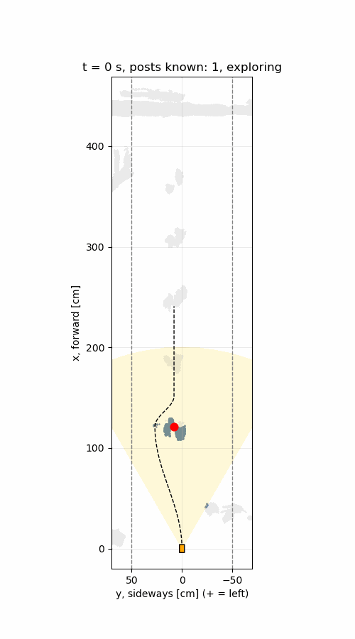
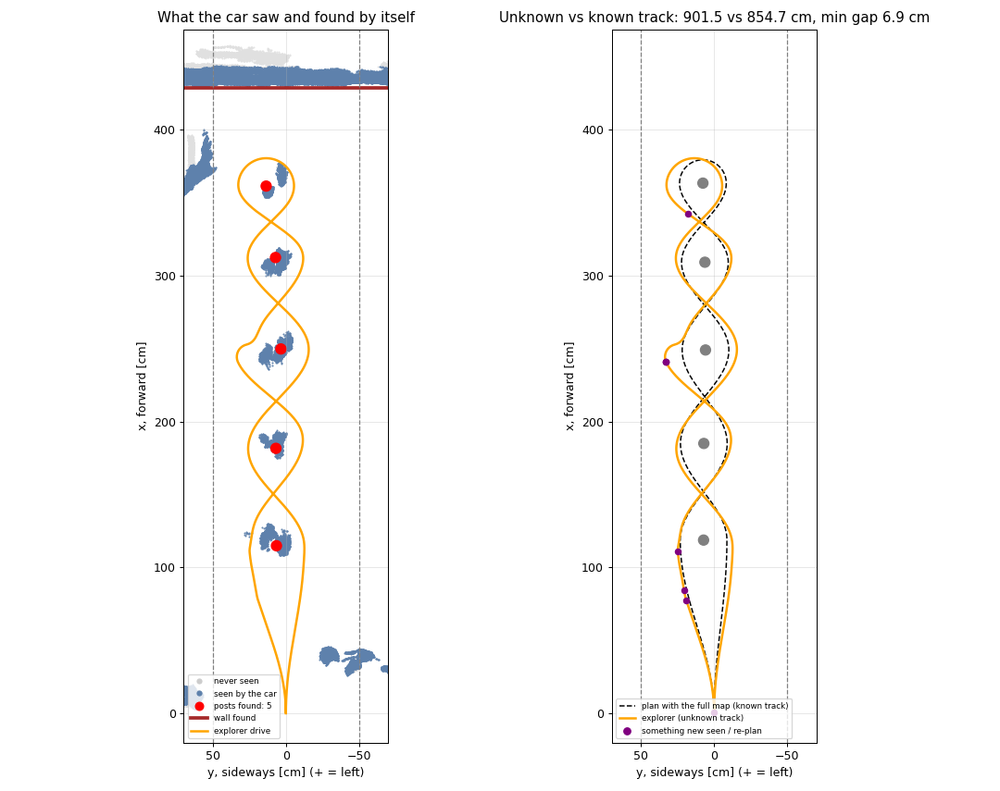
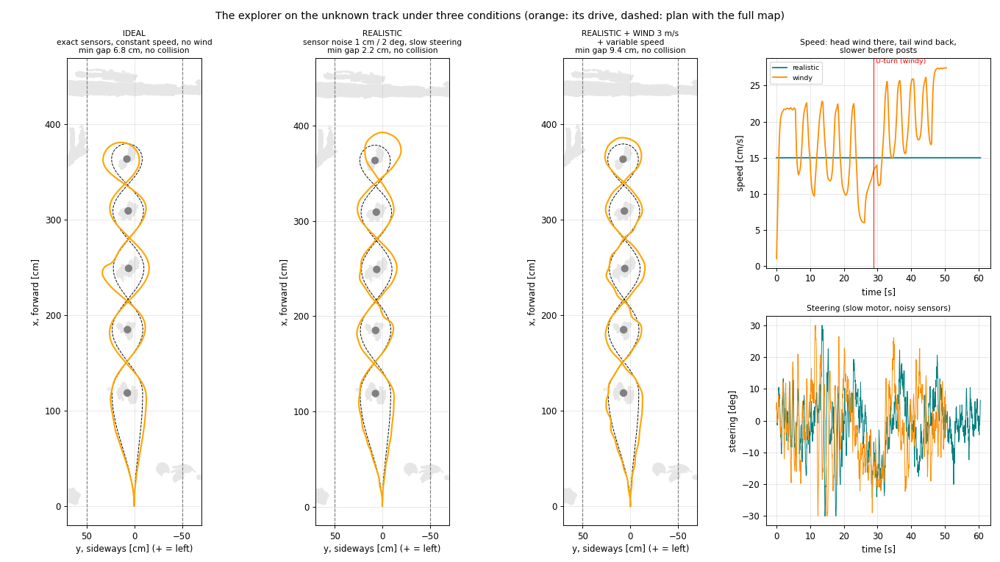
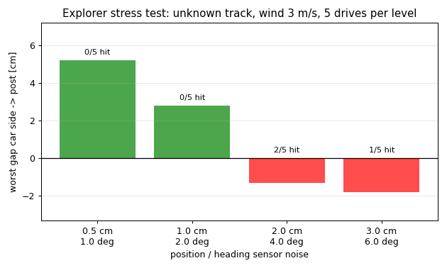

# Minicar Slalom - the explorer: an unknown track (ROS 2 Jazzy in Docker)

> **Branch `lidar-v3`.** A simulated car drives a slalom track it has **never seen before** and
> finds its way by itself.
> 
> Other variants of this project: the camera (branch
> [`main`](https://github.com/MilkaKaplan/minicar-slalom/tree/main))
>
> and the LiDAR map of a track
> driven in advance (branch [`lidar-v2`](https://github.com/MilkaKaplan/minicar-slalom/tree/lidar-v2)).

At a competition the car arrives at a track nobody has measured for it. It has to **find the
posts, decide how to pass them, notice the end of the track, turn around and come back** —
the first time it drives there.

Known in advance are only the **rules** (the start points along a 1 m wide corridor, the
posts stand on its centre line, slalom there, U-turn around the last post, slalom back on the
other side) and **our car** (5 cm wide, max steering 30°).

And it drives under **real conditions**, not in an ideal simulation: its position sensor is
noisy, its steering motor is slow, a **3 m/s wind** blows along the track (in its face on the
way there, in its back on the way back, from the side in the slalom), and it **changes its
speed** like a driver — slower before tight turns.



*The drive with noise, slow steering, wind and variable speed. The yellow cone is the car's
sensor. Grey: not seen yet; blue: seen; red: the posts the car has found so far; dashed: its
current plan, which changes as it discovers the track.*

---

## Contents
- [Quick start](#quick-start)
- [The task](#the-task)
- [The world](#the-world)
- [Pipeline](#pipeline)
- [How the explorer works](#how-the-explorer-works)
- [Driving conditions](#driving-conditions)
- [Results](#results)
- [Limitations](#limitations)
- [Repository layout](#repository-layout)

---

## Quick start

Requirements: **Docker** with **Compose v2** (Docker Desktop on Mac/Windows).

```bash
git clone -b lidar-v3 https://github.com/MilkaKaplan/minicar-slalom.git
cd minicar-slalom
docker compose --profile lidar up --build --exit-code-from lidar_processing lidar_replay lidar_processing
```

The first build downloads ROS 2 Jazzy (~1 GB). The run takes about 3 minutes (the explorer
drives the track 23 times: 3 drives + 20 stress-test drives). Both containers stop by
themselves with exit code 0. The explorer's results are in `results/lidar/`:

| File | Content |
|---|---|
| `explore.gif` | the car exploring the unknown track (windy drive) |
| `explore.png` | what the car saw and found; its path vs the plan with the full map |
| `explore_conditions.png` | the three drives side by side: ideal, realistic, realistic + wind; speed and steering |
| `explore_stress.png` | stress test: more and more sensor noise, 5 windy drives each |
| `explore_result.json` | all three drives (events, posts, wall, re-plans, gaps, speeds) + stress test |

Parameters of the explorer node (`docker/lidar.launch.py`): `sensor_range_cm`,
`sensor_fov_deg`, `gap_cm`, `wind_cm_s` (0 = no wind), `stress_runs`.

If Docker says `network ... not found`, run
`docker compose --profile lidar down --remove-orphans` and start again.

---

## The task

```
                 wall
  ───────────────────────────────
            ╭──●──╮                U-turn around the last post
            ╰╮   ╭╯
             ╳                     ● paper post
            ╭╯   ╰╮                ╳ the path crosses the post line between posts
            ╰──●──╯
              ...                  corridor 1 m wide
            ╭──●──╮
             ╲   ╱
              ▲  start             the car only knows: "the track goes straight ahead"
```

The car must not touch the posts, the corridor edges or the wall, and must come back to the start.

---

## The world

To test the explorer it needs a world to drive in. The world is a **real track**: a slalom of
**5 paper posts** (Ø ≈ 7 cm, ≈ 22 cm high) in a paved yard, recorded with the iPhone LiDAR
([Stray Scanner](https://apps.apple.com/app/stray-scanner/id1557051662) app, folder
`data/lidar_drive/`: 1661 depth frames 256 × 192, confidence, phone poses).

From this recording container 2 builds a 3D map of the yard (≈ 80 000 points above the
ground, the map-building is described in branch
[`lidar-v2`](https://github.com/MilkaKaplan/minicar-slalom/tree/lidar-v2)). The map is the
**world** for the explorer — the explorer never gets it as a whole, only what its own sensor
would see from where it is.


*The same track scanned with Polycam (illustration only).*

---

## Pipeline

Two containers (Ubuntu 24.04, ROS 2 Jazzy, Python 3.12):

```
 ┌── container 1 ─────────────────┐                    ┌── container 2 ───────────────────────────────┐
 │ lidar_replay                   │ /phone/depth       │ lidar_mapper                                 │
 │  plays the iPhone recording    │ /phone/confidence ►│  builds the 3D map of the yard = the WORLD   │
 │  like live sensors             │ /phone/pose        │  ─► /lidar/map ─────────────┐                 │
 │                                │ /phone/camera_info │  ─► /slalom/posts, /path,   │ (only to check  │
 └────────────────────────────────┘                    │     /limits ────────────────┤  the result)    │
                                                       │                             ▼                 │
                                                       │ explorer                                      │
                                                       │  sees the world only through its own sensor,  │
                                                       │  finds posts and wall, plans, re-plans, drives│
                                                       │  ─► /explore/driven_path                      │
                                                       │  ─► results/lidar/explore.png/.gif/.json      │
                                                       └───────────────────────────────────────────────┘
```

| Topic | Message | Used by the explorer for |
|---|---|---|
| `/lidar/map` | `sensor_msgs/PointCloud2` (x, y, height) | **the world** it drives in |
| `/slalom/posts`, `/slalom/path`, `/slalom/limits` | posts, plan and wall on the **full** map | **only to check** the result after the drive |
| `/explore/driven_path` | `nav_msgs/Path` | its drive (output, for RViz or anyone) |

(Container 2 also still runs the full-map planner and car simulator from `lidar-v2`; they
are needed here only as the reference to compare with.)

---

## How the explorer works

Code: `ros2_ws/src/minicar_simulator/minicar_simulator/explorer.py`, node `explorer_node`.
Every **0.05 s** the car does what a self-driving car does — **look → understand → decide → drive**.

**1. Look — its own virtual LiDAR.**
* range **2 m**, field of view **60°** (like the iPhone LiDAR);
* **occlusion**: in every direction (1° wide) it sees only the nearest surface — a post hides
  the posts behind it. From the start it sees **only the first post**;
* everything it sees is remembered: its own map grows while it drives.

**2. Understand — what is in its own map.**
* **posts** = compact things 5–40 cm high, on the corridor's centre line (± 20 cm), standing
  **in a line** (a line is tried through every two candidates — RANSAC idea);
* seeing only the near side of a post, the centre is placed **one radius further away**;
* **wall** = an obstacle at least **50 cm wide** across the corridor (posts are narrow);
  anything behind the wall is a piece of the wall, not a post.

**3. Decide.**
* **first post**: pass it on the side with **more free room** (fewer obstacles there);
* **every new post** → **re-plan**: smooth S-curves through waypoints beside the posts seen so
  far (alternating sides), then straight on along the post line;
* **wall seen and last post passed** → **final plan**: U-turn around the last post and slalom
  back, every post on the other side.

**4. Drive.** Kinematic bicycle model (wheelbase 5 cm, max steering 30°) and a *pure pursuit*
controller aiming 6 cm ahead on the current plan. The car looks 20 times a second and steers
100 times a second, using its **noisy** idea of where it is — see
[Driving conditions](#driving-conditions).

**Safety margin.** A post seen from one side is known less precisely (up to ~9 cm). With a gap
of 10 cm the explorer passed two posts at ~1 cm, so on an unknown track it keeps
**13 cm** — like a careful driver on a road they don't know.

**Solving it step by step** (each problem found by looking at the result):

| Problem | Fix |
|---|---|
| the sensor saw "through" posts (3 posts at once from the start) | occlusion: only the nearest surface in every direction |
| a thing near the start and pieces of the wall were taken for posts | posts must be on the centre line and in a line; the wall is searched first, posts behind it are dropped |
| the wall was searched behind a false post and found too late | search the wall anywhere after the first post |
| passed two posts at ~1 cm | centre one radius behind the visible side + 13 cm safety gap |
| with noise and slow steering it sometimes hit post 4: one post (seen "doubled") was taken as two posts ~20 cm apart, so the car turned around the false "last post" too early | pieces closer than 30 cm along the line are one post (real posts are ~60 cm apart); turn around only if the last post is within 1.5 post spacings of the wall — otherwise an unseen post may still be there, keep driving and looking |

---

## Driving conditions

The explorer drives the unknown track three times (same settings as the car simulator of
branch `lidar-v2`):

| Drive | Position sensor | Steering motor | Speed | Wind |
|---|---|---|---|---|
| **Ideal** | exact | instant | constant 15 cm/s | none |
| **Realistic** | noise 1 cm, heading 2° | max 120°/s | constant 15 cm/s | none |
| **Realistic + wind** (main result) | noise 1 cm, heading 2° | max 120°/s | **variable** | **3 m/s** |

* **Noisy sensor**: every 0.01 s the car gets its position and heading with a random error
  and steers by that (fixed random seeds, so the results are reproducible).
* **Slow steering motor**: the wheels follow the command at most 120° per second.
* **Wind 3 m/s along the corridor, from the wall towards the start**: a **head wind** on the way
  there (air drag `0.0001 · v_air · |v_air|` slows the car), a **tail wind** on the way back
  (it pushes the car), and when the car drives at an angle in the slalom or across in the
  U-turn, the side part of the wind **pushes it sideways** (0.01 × side wind, cm/s).
* **Variable speed**: the car starts from standstill, looks 15 cm ahead on its plan and slows
  down before tight turns (v ≤ √(10 cm/s² · R)), speeds up to at most 25 cm/s on straighter
  parts, acceleration ≤ 30 cm/s², braking ≤ 40 cm/s².

---

## Results

What happened in the main drive — noise, slow steering, wind, variable speed
(`results/lidar/explore_result.json`, `windy`):

| Time | Event |
|---|---|
| 0.0 s | **post 1** seen, 1.22 m ahead — posts 2–5 are hidden behind it → pass it on the **left** (more room) |
| 4.2 s | **post 2** seen, 1.16 m ahead → re-plan |
| 4.3 s | **post 3** seen, 1.70 m ahead → re-plan |
| 5.8 s | **post 4** seen, 2.02 m ahead → re-plan |
| 11.3 s | **post 5** seen, 1.88 m ahead → re-plan |
| 14.9 s | the **wall** seen, 1.91 m ahead (for an instant a piece of it looked like a post; dropped as soon as the wall was recognised) |
| 23.6 s | last post passed → **final plan**: U-turn and back |
| 50.4 s | back at the start |



*Left: what the car saw (blue) and never saw (grey), the posts and wall it found and its drive.
Right: its drive (orange) vs the plan made with the full map (dashed); purple dots: moments
when it saw something new and re-planned.*

| | Explorer (unknown track, wind) | Plan with the full map (known track) |
|---|---|---|
| Posts found | **5 of 5** | 5 |
| Wall | 429.1 cm from the start | 427.5 cm |
| First post passed on | left (chosen by free room) | left |
| Re-plans | 7 | — |
| Path length | 901.1 cm | 854.7 cm |
| Distance between the two paths | **2.4 cm** on average, 6.6 cm at most | — |
| Smallest gap to a post | **9.4 cm** (planned 13) | 10.0 cm |
| Furthest from the centre line | 26.6 cm (corridor edge at 50 cm) | — |
| Collisions | **none** | none |
| Time | 50.4 s | — |

### Ideal vs realistic vs wind



| Drive | Time | Mean speed there / back | Path | Smallest gap to a post | Collision |
|---|---|---|---|---|---|
| Ideal | 59.9 s | 15 / 15 cm/s | 899 cm | 6.8 cm | none |
| Realistic (noise + slow steering) | 60.6 s | 15 / 15 cm/s | 909 cm | **2.2 cm** | none |
| Realistic + wind 3 m/s + variable speed | 50.4 s | **15.6 / 20.7 cm/s** | 901 cm | 9.4 cm | none |

* The noisy sensor makes the steering **jittery** (right panel) and in this drive brings the car
  to **2.2 cm** from the last post — much closer than the ideal car.
* With wind, the car is **slower on the way there** (head wind) and **faster on the way back**
  (tail wind pushes it up to 27 cm/s); it slows down before every post.
* One drive of each says little about luck — hence the stress test.

### Stress test: how good must the car's position sensor be?



5 windy drives (wind 3 m/s, slow steering, variable speed) for each noise level, each with a
different random noise:

| Sensor noise (position / heading) | Posts found | Worst gap to a post | Collisions |
|---|---|---|---|
| 0.5 cm / 1° | 5 in all drives | 5.2 cm | **0 / 5** |
| 1 cm / 2° | 5 in all drives | 2.8 cm | **0 / 5** |
| 2 cm / 4° | 5 in all drives | −1.3 cm | **2 / 5** |
| 3 cm / 6° | 5 in all drives | −1.8 cm | **1 / 5** |

→ On an unknown track with wind, the car needs to know its position to about **1 cm**; with
2 cm or more it sometimes touches a post. The same limit as for the car that knew the track
(branch `lidar-v2`).

**The car found the whole track by itself, under wind and with noisy sensors, and drove it
only ~5 % longer than a car that knew the track in advance — as long as its position sensor
is accurate to about 1 cm.**

This is a **rule-based** robot (perception → planning → control), not machine learning:
every decision can be explained. A reinforcement-learning car would instead learn by trial
and error over thousands of drives with a reward (progress +, collision −).

---

## Limitations

* **The world is a map, not live sensor data**: the explorer's sensor is simulated on the
  LiDAR map of the yard. That map itself has the drift of the phone that recorded it (post
  spacing ~15 % too long) and posts that look "doubled" (seen from both sides a few cm apart).
* **Simple LiDAR model**: range, field of view and occlusion, but no noise or missing points in
  the LiDAR itself; the car builds its own map with its true position (only the steering uses
  the noisy position).
* **Rules assumed**: the start points along the corridor and the posts stand on its centre line.
* **One track**: 5 posts in a line; a curved or irregular track would need more general rules.
* **Simple car and wind models**: no wheel slip; constant wind without gusts; drag and drift
  coefficients chosen for a toy car — they show the direction of the effects, not exact numbers.
* **Few random drives**: 5 per noise level in the stress test; more drives would give more
  reliable collision rates.

---

## AI assistance
Code was written with the help of Claude (Anthropic) as a programming assistant. 
The task, the track design, all data collection (photos, video, iPhone LiDAR recording) and the decisions on what to test - Milka Kaplan.

Reviewed and ran every step was by Milka Kaplan.

___
## Repository layout

```
.
├── docker-compose.yml          profile "lidar": the pipeline
├── docker/
│   ├── Dockerfile.publisher    container 1: Ubuntu 24.04 + ROS 2 Jazzy + minicar_publisher
│   ├── Dockerfile.processor    container 2: + minicar_processor + minicar_simulator
│   ├── lidar.launch.py         lidar_mapper + car_simulator + explorer in container 2
│   └── entrypoint.sh
├── ros2_ws/src/
│   ├── minicar_publisher/      lidar_replay_node (container 1)
│   ├── minicar_processor/      lidar_map.py, lidar_mapper_node.py (builds the world), core.py (planner)
│   └── minicar_simulator/      explorer.py + explorer_node (the explorer),
│                               sim.py + simulator_node (reference drive on the full map)
├── data/lidar_drive/           the LiDAR recording of the track + hand measurements + Polycam scan
├── docs/images/lidar/          figures for this README
└── results/                    pipeline output (not in git)
```

## License

MIT
