# Minicar Slalom — a ROS 2 Jazzy pipeline in Docker

A toy autonomous-driving pipeline: a small car has to drive a **slalom between 4 posts,
turn around at the end and slalom back** inside a 1 m wide corridor.

The pipeline takes a **photo of the track taken from above** (our own dataset), finds the
posts, plans a safe path, checks it, and lets a **simulated car** drive it. As an extra, the
**drive video** filmed from the floor is streamed through the same pipeline like a car's
front camera.

| Planned path on the photo and on the map | Simulated car driving it |
|---|---|
| 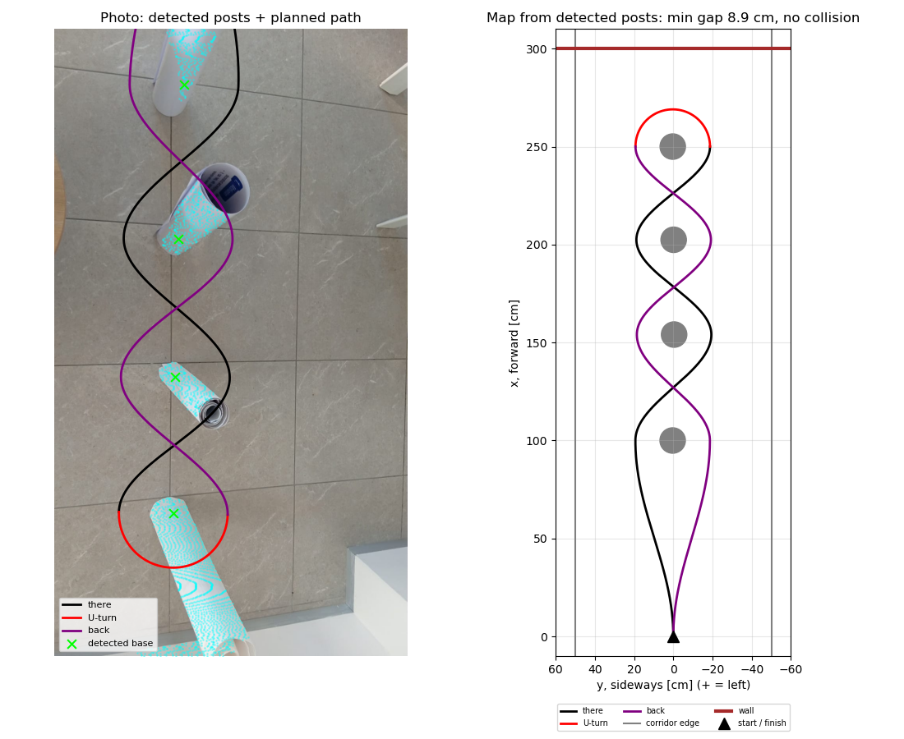 | 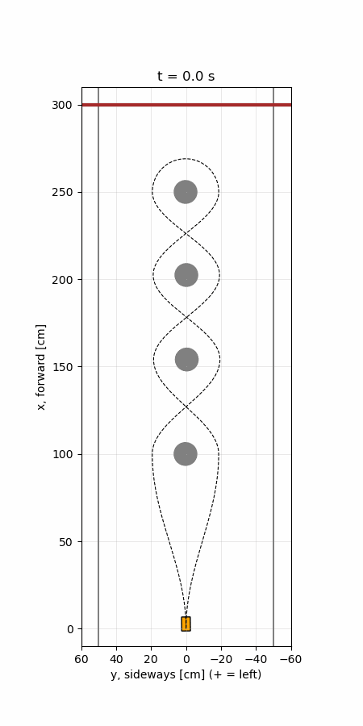 |

---

## Contents
- [Quick start](#quick-start)
- [The task](#the-task)
- [Dataset](#dataset)
- [Pipeline](#pipeline)
- [How it works](#how-it-works)
- [Results](#results)
- [Extra: the drive video as a front camera](#extra-the-drive-video-as-a-front-camera)
- [Extra: iPhone LiDAR — a track nobody measured for us](#extra-iphone-lidar--a-track-nobody-measured-for-us)
- [Limitations](#limitations)
- [Repository layout](#repository-layout)

---

## Quick start

Requirements: **Docker** with **Compose v2** (Docker Desktop on Mac/Windows). Nothing else.

```bash
git clone https://github.com/MilkaKaplan/minicar-slalom.git
cd minicar-slalom
docker compose up --build --exit-code-from processor
```

The first build downloads ROS 2 Jazzy (~1 GB, a few minutes). The run itself takes ~20 s.
Both containers stop by themselves and the command returns exit code 0.

Results appear in `results/`:

| File | Content |
|---|---|
| `slalom_plan.png` | detected posts + planned path, on the photo and as a map |
| `result.json` | post positions, gaps, turn radii, path length |
| `path.csv` | the path as points `(part, x_cm, y_cm)` — what a real car would follow |
| `sim_ideal.png/.gif`, `sim_realistic.png/.gif` | the simulated car driving the path |
| `sim_robustness.png`, `sim_result.json` | 40 drives with more and more sensor noise |

Other commands:

```bash
# Extra: the drive video as a front-camera stream (results in results/video/)
docker compose --profile video up --build --exit-code-from video_checker video_publisher video_checker

# Extra: iPhone LiDAR recording, map built without track measurements (results in results/lidar/)
docker compose --profile lidar up --build --exit-code-from lidar_processing lidar_replay lidar_processing

# Dataset statistics and figures (writes docs/)
docker compose run --rm stats

# Experiments without changing code, e.g. a car that cannot steer as much, or a smaller gap
docker compose run --rm processor ros2 launch /ros2_ws/processing.launch.py max_steer_deg:=10.0
docker compose run --rm processor ros2 launch /ros2_ws/processing.launch.py gap_cm:=5.0

# Stop everything
docker compose down
```

---

## The task

```
                 wall
  ─────────────────────────────────  x = 300 cm
            ╭──●──╮                  U-turn around post 4
            ╰╮   ╭╯
             ╳                       ● post (Ø ≈ 13 cm)
            ╭╯   ╰╮                  ╳ the path crosses the post line
            ╰──●──╯                    between the posts
              ...                    corridor: 1 m wide (50 cm each side)
            ╭──●──╮  x = 100 cm      posts 50 cm apart
             ╲   ╱
              ▲      x = 0           start, 1 m before post 1
```

* 4 posts in a line, **50 cm** apart, in a corridor **1 m** wide.
* The car (5 cm wide) starts **1 m** before post 1, drives a slalom to the wall
  (50 cm after post 4), **turns around post 4** and slaloms back, passing every post on
  the **other** side (a figure of eight).
* Wanted gap between a post and the side of the car: **5–10 cm** (we use 10 cm).

The idea of the path comes from a hand drawing on the top-view photo
(black = there, purple = back):

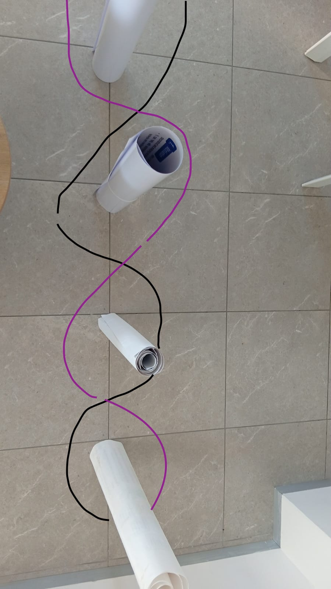

---

## Dataset

Own dataset, filmed in an office with paper rolls as posts.
Statistics are computed by `scripts/dataset_stats.py`, all numbers are in
[`docs/dataset_stats.json`](docs/dataset_stats.json).

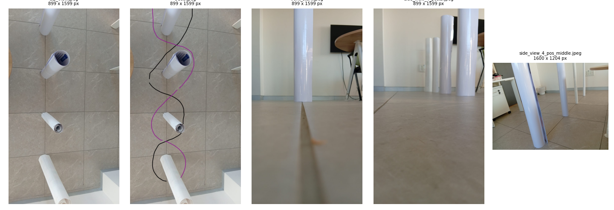

| File | What it is | Size |
|---|---|---|
| `data/top_view.jpeg` | **input of the pipeline**: top view, phone held ≈2 m above the track | 899 × 1599 px |
| `data/trace.jpeg` | the same photo with the path drawn by hand | 899 × 1599 px |
| `data/front_start.jpeg` | the car's view at the start | 899 × 1599 px |
| `data/side_view_4_posts.jpeg` | side view of the 4 posts | 899 × 1599 px |
| `data/side_view_4_pos_middle.jpeg` | first test photo | 1600 × 1204 px |
| `data/drive_video.mp4` | the drive filmed from the floor: there, U-turn, back | 480 × 860 px, 30 fps, 45 s, 1350 frames |

All files were sent through WhatsApp, so they are **compressed** (small resolution).

### Track dimensions

**Exact, from the floor tiles (50 × 50 cm)**: the posts stand on tile corners, so the
post spacing (50 cm), the corridor (1 m), the start (1 m before post 1) and the wall
(50 cm after post 4) are whole tiles.

**Approximate**: post diameter ≈ 13 cm, post height ≈ 1 m, camera height for the top
view ≈ 2 m. The pipeline does not use the camera height: it takes the scale from the
photo itself.

### Hand labels

Two things were labelled by hand:

* **Post bases on the top view** (pixels): (300, 160), (310, 520), (300, 890), (300, 1250).
  Check against the tile grid: the labelled spacings are **49.5 / 50.9 / 49.5 cm**
  (tile = 50 cm), so the labels are accurate to **< 1 cm**. Scale: **7.27 px per cm**.
* **Phases of the drive video** (by watching it, ±1–2 s): there 0–14 s, U-turn 14–22 s,
  back 22–40 s, end 40–45 s.

### Video statistics

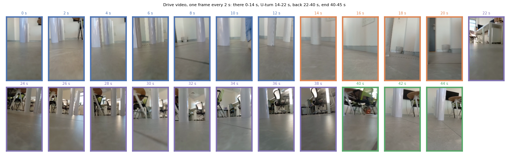
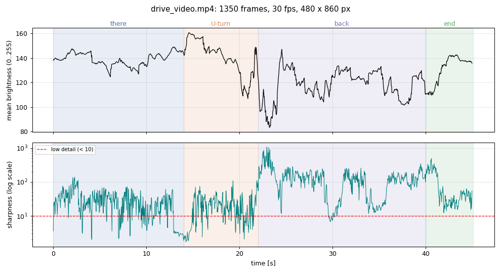

| Phase | Time | Frames | Mean brightness | Sharpness (median) | Blurred / featureless frames |
|---|---|---|---|---|---|
| there | 0–14 s | 420 | 139 | 25 | 84 |
| U-turn | 14–22 s | 240 | 141 | 17 | 76 |
| back | 22–40 s | 540 | 119 | 118 | 17 |
| end | 40–45 s | 150 | 131 | 40 | 0 |

* **177 of 1350 frames (13 %)** are blurred or almost featureless (sharpness < 10),
  most of them during the U-turn when the camera turns fast.
* The way back is darker (windows in the background) and has **5× more detail**
  (chairs, tables) — more things that look like posts.

---

## Pipeline

Two containers (Ubuntu 24.04, ROS 2 Jazzy, Python 3.12), three ROS 2 nodes:

```
 ┌──── container 1: publisher ────┐            ┌──────────── container 2: processor ─────────────┐
 │                                │            │                                                  │
 │ data/top_view.jpeg             │ /camera/   │  slalom_processor                                │
 │   └► top_view_publisher ───────┼─top_view──►│   find posts → cm → plan path → checks           │
 │      (1 image per second)      │ (Image)    │   ├─► results/slalom_plan.png, result.json, ...  │
 │                                │            │   ├─► /slalom/path   (nav_msgs/Path)  ─┐         │
 └────────────────────────────────┘            │   └─► /slalom/posts  (PoseArray)      ─┤         │
                                               │                                        ▼         │
                                               │  car_simulator                                   │
                                               │   drives the path: ideal, realistic, stress test │
                                               │   ├─► results/sim_*.png/.gif, sim_result.json    │
                                               │   └─► /sim/driven_path (nav_msgs/Path)           │
                                               └──────────────────────────────────────────────────┘
```

| Topic | Message | From → to |
|---|---|---|
| `/camera/top_view` | `sensor_msgs/Image` (rgb8, 899 × 1599) | publisher → processor |
| `/slalom/path` | `nav_msgs/Path` (metres, frame `track`) | processor → simulator |
| `/slalom/posts` | `geometry_msgs/PoseArray` | processor → simulator |
| `/sim/driven_path` | `nav_msgs/Path` | simulator → (RViz, anyone) |

* The processor does **not** read files from `data/`: it only gets the image through ROS 2.
  It would work the same with a live camera instead of the publisher.
* Topics are RELIABLE + TRANSIENT_LOCAL, so a node that starts later still gets the last
  message. DDS: Cyclone DDS over a Docker bridge network.
* Container 2 runs the processor and the simulator together with `docker/processing.launch.py`.

---

## How it works

### 1. Finding the posts on the top view (`core.detect_posts`)

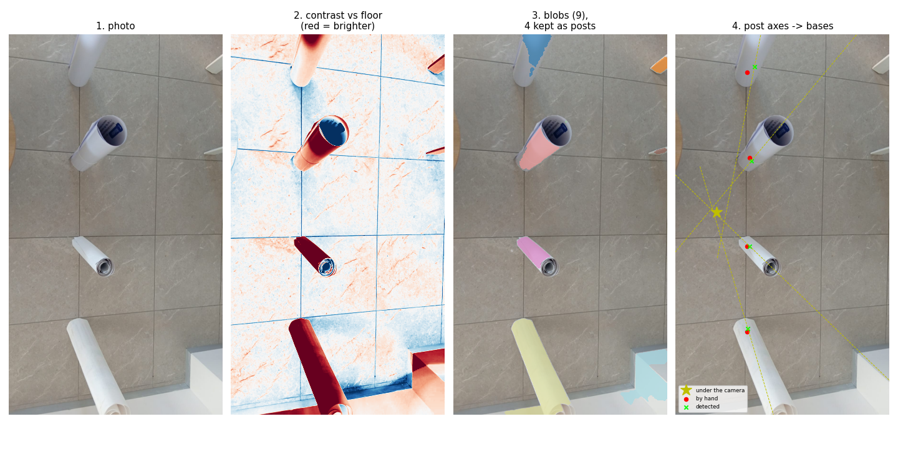

1. **Contrast**: for every pixel, how much brighter it is than the floor around it
   (median over a ~400 px window). Light is uneven across the photo, so one global
   threshold does not work.
2. **Mask**: contrast > 10 and not coloured (removes the wooden table).
3. **Blobs**: clean the mask (removes marble veins and tile seams), split into connected
   pieces; keep large ones that do not touch the left/right edge (walls, furniture).
4. **Bases**: seen from above, a standing post seems to "fall" away from the point under
   the camera (perspective). So all post axes meet at that point (yellow star). The base
   is the end of the post closer to that point, moved in by one post radius.

### 2. Pixels → centimetres

The scale comes from the photo: detected posts are 50 cm apart → **7.30 px/cm**.
A line is fitted through the posts; `x` = forward from the start, `y` = sideways
(+ = car's left).

### 3. Path planning (`core.plan_path`)

* For every post a **waypoint** at `A = post radius + gap + half car width = 6.5 + 10 + 2.5 = 19 cm`
  beside it, alternating sides.
* Waypoints are joined by smooth **half-cosine S-curves** (the car drives straight at each
  waypoint, no kinks). The entry from the start is one gentle sideways move over 1 m.
* **U-turn**: half circle of radius A around the last post.
* **Back**: mirror image of the way there, every post on the other side.

### 4. Checks (`core.check_path`)

Gap to every post **along the whole path** (not only next to the posts — the path
cuts corners between them), gap to the corridor edge and the wall, and the tightest
turn radius `R = 1 / curvature`.

### 5. Car simulator (`minicar_simulator/sim.py`)

* **Car model**: kinematic bicycle, wheelbase 5 cm, max steering 30° →
  smallest turn radius `R_min = 5 / tan 30° = 8.7 cm`, speed 20 cm/s.
* **Controller**: *pure pursuit* — the car aims at a point of the path 6 cm ahead.
* **Ideal** run: perfect sensors, wheels turn instantly.
* **Realistic** run: position sensor noise 1 cm, heading noise 2°, steering motor 120°/s.
* **Stress test**: 10 drives each with noise 0.5 / 1 / 2 / 3 cm (fixed random seeds, so
  the results are reproducible).

The car never sits on the path: its position changes only through speed and steering,
so it can fail (see the steering table below).

---

## Results

### Detection and path

| | Value |
|---|---|
| Posts found | **4 of 4** |
| Detection error vs. hand labels | 4.9 / 2.2 / 1.2 / 2.1 cm (mean **2.6 cm**) |
| Post positions (x, y) | (100.0, 0.3), (154.1, −0.4), (202.4, −0.2), (250.0, 0.3) cm |
| Smallest gap car ↔ post | **8.9 cm** (planned 10 cm; the path cuts corners) |
| Gap to corridor edge / wall | 28.1 cm / 28.5 cm |
| Tightest turn | there 12.0 cm, U-turn 19.0 cm, back 11.9 cm |
| Path length | 652 cm |

Post 1 has the largest error: its lower half is in shadow and almost as dark as the floor.

### Choosing the detection threshold

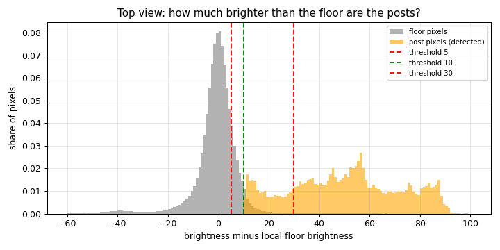

| Contrast threshold | Result |
|---|---|
| 5 | too loose: 19 blobs, post 4 merges with the wall → **3 of 4 posts** |
| **10** | **4 of 4 posts, mean error 2.6 cm** |
| 30 | too strict: only pieces of the shaded posts 1–2 → 4 of 4 but errors up to **20 cm** |

Only 3.5 % of the floor pixels are brighter than threshold 10.

### How sharp is the slalom?

For a sine-like slalom the tightest turn is

**R ≈ (d / π)² / A**

(d = post spacing, A = sideways swing). With d = 50 cm and A = 19 cm: R ≈ 13 cm; the
detected spacings 54 / 48 / 48 cm give the 12 cm above. Doubling the spacing to 1 m
would make the turns **4× gentler** (R ≈ 53 cm). A smaller gap to the posts also makes
the turns gentler, but leaves less safety margin — a trade-off.

### Simulated drives

| Ideal car | Realistic car (noise + slow steering) |
|---|---|
| 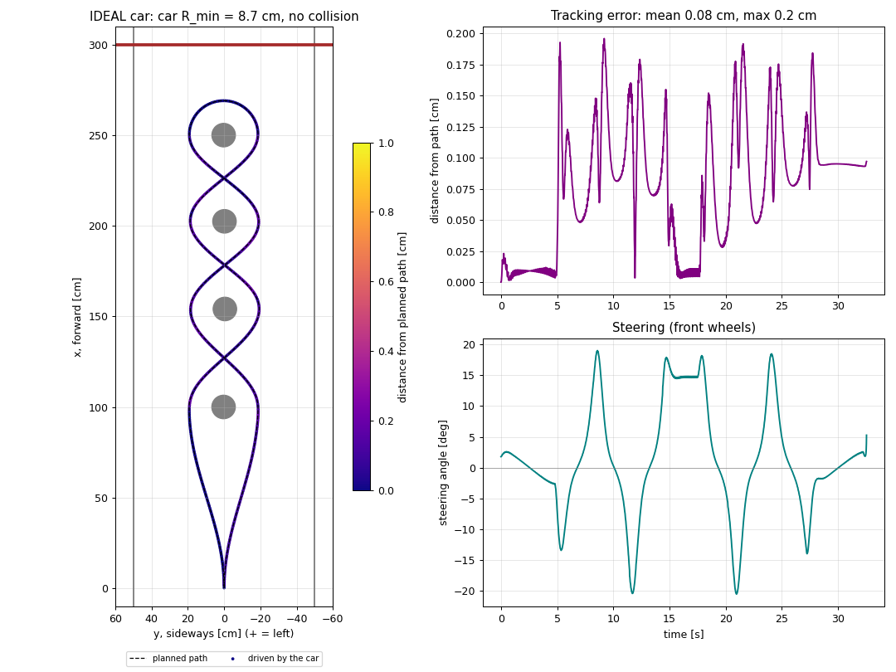 | 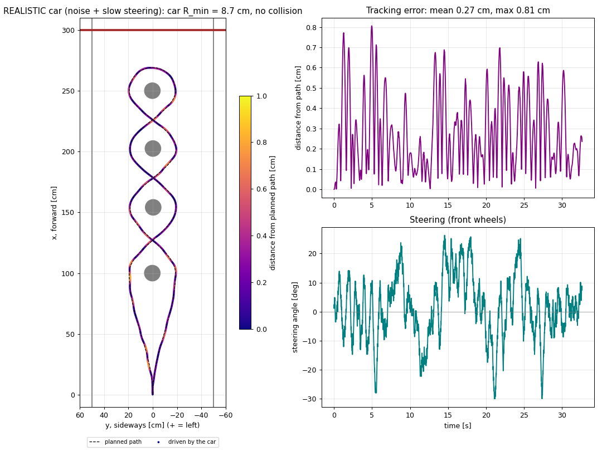 |

| | Ideal | Realistic |
|---|---|---|
| Distance from the planned path: mean / max | 0.08 / 0.20 cm | 0.27 / 0.81 cm |
| Smallest gap to a post | 8.8 cm | 8.4 cm |
| Steering used (max 30°) | 20.5° | 30.0° |
| Collision | no | no |
| Drive time | 32.5 s | 32.7 s |

**Which car can drive this track?** (`scripts/steering_sweep.py`, ideal car)

| Max steering | R_min | Error mean / max | Smallest gap | |
|---|---|---|---|---|
| 30° | 8.7 cm | 0.08 / 0.20 cm | 8.8 cm | OK |
| 20° | 13.7 cm | 0.08 / 0.20 cm | 8.8 cm | OK |
| 15° | 18.7 cm | 0.33 / 2.33 cm | 8.8 cm | OK |
| 12° | 23.5 cm | 1.82 / 9.34 cm | 8.8 cm | OK |
| 11° | 25.7 cm | 4.37 / 17.0 cm | 7.3 cm | OK |
| 10° | 28.4 cm | 13.6 / 38.9 cm | −5.6 cm | **collision** |

→ The car must be able to turn with a radius of about **25 cm or less**.

### Robustness: how good must the car's position sensor be?

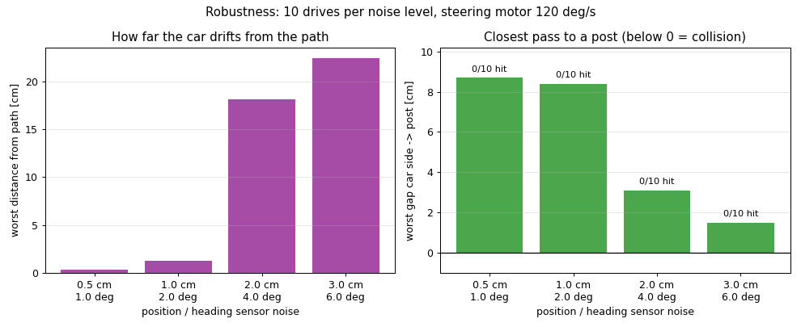

| Sensor noise (position / heading) | Worst distance from path | Worst gap to a post | Collisions |
|---|---|---|---|
| 0.5 cm / 1° | 0.4 cm | 8.7 cm | 0 / 10 |
| 1 cm / 2° | 1.2 cm | 8.4 cm | 0 / 10 |
| 2 cm / 4° | 18.2 cm | 3.1 cm | 0 / 10 |
| 3 cm / 6° | 22.4 cm | 1.5 cm | 0 / 10 |

→ Up to **1 cm** of sensor error the car keeps > 8 cm from the posts. From **2 cm** it
drifts up to 18–22 cm off the path and almost touches the posts. A slow steering motor
alone does no harm — the problem is noise *and* slow steering together.

---

## Extra: the drive video as a front camera

A separate, optional version of the pipeline (Compose profile `video`):

```
container 1: video_publisher ── /camera/front (Image, 10 frames per video second) ──► container 2: video_checker
```

* `video_publisher` plays `drive_video.mp4` like the car's front camera (450 frames);
  the header stamp of each frame is its time in the video.
* `video_checker` looks for posts on every frame: on the video the posts are **cool**
  (bluish) white, the wall and floor **warm** white. It marks the nearest post and saves
  `results/video/video_check.png`, `video_detections.gif` and `video_check.json`.

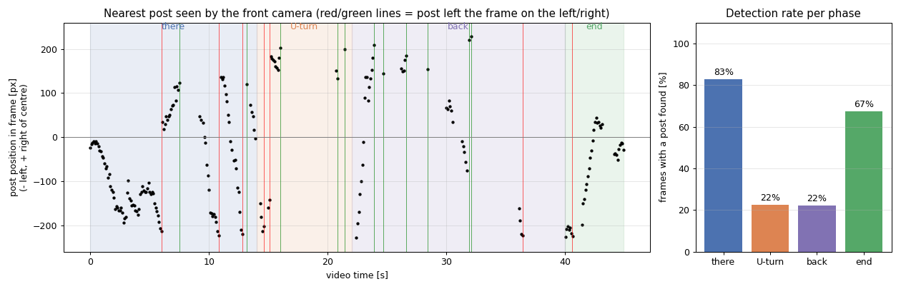
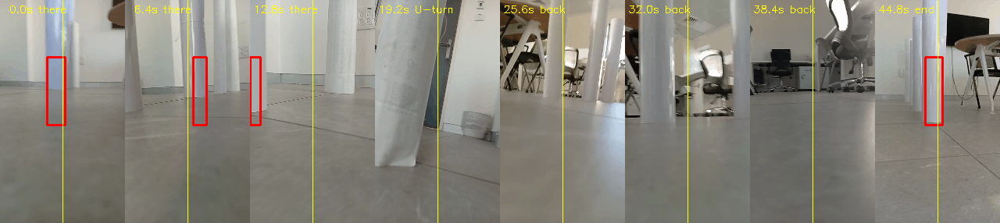

| Phase | Frames with a post found |
|---|---|
| there (white wall behind) | **83 %** |
| U-turn (few posts in view) | 22 % |
| back (windows, chairs) | **22 %** |
| end | 67 % |

**Honest result:** on the way there the camera clearly sees the slalom — the nearest
post slides to the left edge, then the next one to the right, and so on. On the way back
the light from the windows changes the colours and white chair legs look like posts,
so the detector misses most posts. The left/right sequence is therefore **not reliable
enough** to confirm the planned slalom from the video.

The video does **not** steer the car — the path comes from the top view. In a real car
a live front camera could correct the car's position using the posts as landmarks
(*localization*), which is exactly what the robustness test asks for (≈ 1 cm accuracy).
That would need coloured posts or a trained detector.

---

## Extra: iPhone LiDAR — a track nobody measured for us

The main pipeline needs to know the track (posts 50 cm apart) to get its scale. On a
competition track nobody tells you that. In this version the system **measures everything
itself** from the iPhone's LiDAR; known in advance are only **our car** (5 cm wide, wanted
gap 10 cm) and the **rules** (corridor 1 m wide).

**Data** (`data/lidar_drive/`): a new slalom in a paved yard — 5 paper posts (Ø ≈ 7 cm),
recorded with the [Stray Scanner](https://apps.apple.com/app/stray-scanner/id1557051662)
app while driving the phone ≈ 5–10 cm above the ground: there, U-turn, back.
48 s, 1661 frames of **depth** (256 × 192, mm), **confidence** (low/medium/high) and the
**phone pose** from ARKit (position + orientation). Hand measurements are in
`measurements.json` and are used **only to check** the result.

 <br>
*The same track scanned with Polycam (for illustration only).*

```
 ┌── container 1 ─────────────────┐            ┌── container 2 ─────────────────────────────────┐
 │ lidar_replay                   │ /phone/depth       │ lidar_mapper                            │
 │  data/lidar_drive/ ────────────┼ /phone/confidence ►│  frames → 3D map → ground → posts → wall │
 │  (plays the recording like     │ /phone/pose        │  → plan slalom → compare with real drive │
 │   live sensors)                │ /phone/camera_info │  ─► /slalom/path, /posts, /limits ─┐     │
 └────────────────────────────────┘                    │ car_simulator ◄──────────────────────┘   │
                                                       └──────────────────────────────────────────┘
```

```bash
docker compose --profile lidar up --build --exit-code-from lidar_processing lidar_replay lidar_processing
# results in results/lidar/
```

**How the map is built** (`minicar_processor/lidar_map.py`):

1. every depth pixel → 3D point in the camera (focal length from `camera_info`) → 3D point
   in the world (phone pose). Only high-confidence points closer than 2 m.
2. **ground** = the most common height + a fitted plane (thickness 2 cm);
3. **posts** = compact things 5–40 cm above the ground near the drive; pieces of one object
   are merged, and only candidates **standing in one line** are kept (7 candidates → 5 posts);
4. **wall** = the first obstacle behind the last post that is at least 50 cm wide;
5. the slalom is planned with the same planner as the main pipeline, the car simulator drives it.


| | LiDAR (automatic) | Hand measurement |
|---|---|---|
| Posts | **5** | 5 |
| Post spacing | 66 / 64 / 60 / 54 cm, mean **61 cm** | ≈ 53 cm |
| Last post → wall | **64 cm** | 62 cm |
| Start of recording → post 1 | 119 cm | 93 cm (the recording started before the start mark) |
| Ground flatness | 2 cm | — |

| Result | Value |
|---|---|
| Planned path: smallest gap to a post | 10.0 cm, corridor edge 23.8 cm, wall 45.5 cm |
| Tightest turn | 16–19 cm |
| **Real drive vs plan** (the phone's path) | **6.7 cm** apart on average, 21 cm at most |
| Simulated realistic car | max 1.0 cm from the path, ≥ 9.1 cm from every post, no collision |

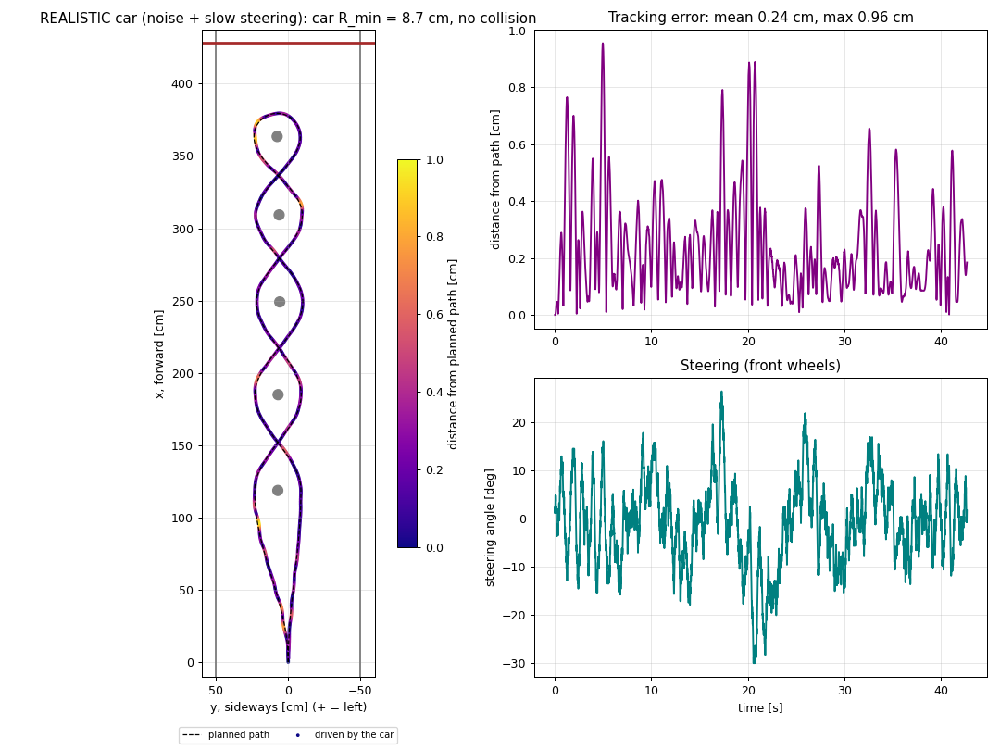

**Honest notes**

* The wall distance matches the tape measure (64 vs 62 cm), but the post spacing comes out
  ~15 % longer (61 vs 53 cm) and uneven (54–66 cm), while the Polycam scan shows evenly
  spaced posts. The phone's own position (ARKit) drifts when it is carried very low over a
  uniform paved floor — there is little texture for it to track.
* Each post is seen from both sides (there and back); with the drift its two halves land a
  few cm apart, so post centres are only accurate to ~3–5 cm.
* The phone itself passed post 4 closer than a 5 cm car would be allowed to — the human
  "driver" was less careful than the planner.

---

## Limitations

* **Small, compressed data**: one top-view photo and one video, both compressed by WhatsApp.
* **Shadows**: post 1 is partly in shadow → largest detection error (4.9 cm).
* **Approximate sizes**: post diameter and camera height are estimates
  (± 1 cm in diameter changes the gaps by ± 0.5 cm).
* **Little room at the wall**: only 50 cm after post 4 — the car cannot straighten out
  and stop there, so it turns around post 4 instead.
* **Idealised simulator**: no wheel slip, constant speed, the car body is checked by its
  width only. Real errors will be larger than in the simulation.
* **Video detection** depends on the light and fails with a busy background.

---

## Repository layout

```
.
├── docker-compose.yml          main pipeline + "video" profile + "stats" tool
├── docker/
│   ├── Dockerfile.publisher    container 1 (Ubuntu 24.04 + ROS 2 Jazzy + minicar_publisher)
│   ├── Dockerfile.processor    container 2 (+ minicar_processor + minicar_simulator)
│   ├── processing.launch.py    starts processor + simulator in container 2
│   ├── lidar.launch.py         starts lidar_mapper + simulator in container 2 (LiDAR version)
│   └── entrypoint.sh
├── ros2_ws/src/
│   ├── minicar_publisher/      top_view_publisher, video_publisher, lidar_replay (container 1)
│   ├── minicar_processor/      core.py (detection, planning, checks), processor_node,
│   │                           front_camera.py + video_checker_node (video version),
│   │                           lidar_map.py + lidar_mapper_node (LiDAR version)
│   └── minicar_simulator/      sim.py (car model, pure pursuit, noise), simulator_node
├── data/                       the dataset (photos, video) + data/lidar_drive/ (iPhone LiDAR recording)
├── scripts/
│   ├── step1_look.py … step4_pipeline.py   how the solution was built, step by step (no ROS)
│   ├── dataset_stats.py        dataset statistics → docs/
│   ├── steering_sweep.py       which steering limit is enough
│   └── update_docs.sh          copies result figures into docs/images
├── docs/                       README figures, dataset_stats.json, steering_sweep.json
└── results/                    pipeline output (not in git)
```

The scripts in `scripts/` run with a normal Python (numpy, scipy, matplotlib, Pillow);
`dataset_stats.py` needs OpenCV and runs in Docker (`docker compose run --rm stats`).

## License

MIT
